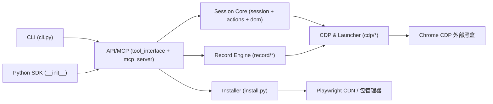

# 多态组件总表与 Tier 3 工具归档

本仓按框架机制归入五类组件：API 服务、UI/CLI、核心引擎、异步 Worker、存储与传输底座。组件之间只有一个共享收口 `browser_tool()`，没有跨仓依赖边。

## 1. 组件注册表

| 组件标识 | 框架原型 | 核心源码 | 入口符号 | 上游 | 下游 | 文档 |
|---|---|---|---|---|---|---|
| `api-and-mcp` | API Service | `mcp_server.py`、`tool_interface.py`、`__init__.py` | `call_tool` (`src/octop_browser/mcp_server.py:391`)、`browser_tool` (`src/octop_browser/tool_interface.py:91`) | CLI、外部 MCP 客户端、Python 调用方 | `session-core`、`record-engine`、`installer` | [api-and-mcp.md](api-and-mcp.md) |
| `cli` | UI / CLI | `cli.py` | `main` (`src/octop_browser/cli.py:631`)、`_build_parser` (`:96`) | 终端用户、脚本 | `api-and-mcp`、`record-engine`、`installer` | [cli.md](cli.md) |
| `session-core` | Core Engine | `session.py`、`actions/*`、`dom/*`、`hooks.py` | `BrowserSession` (`src/octop_browser/session.py:174`) | `api-and-mcp` | `cdp-and-launcher` | [session-core.md](session-core.md) |
| `cdp-and-launcher` | DAO / 传输底座 | `cdp/*`、`profile.py`、`idle.py` | `CDPClient.send` (`src/octop_browser/cdp/client.py:75`)、`launch_or_attach` (`src/octop_browser/cdp/launcher.py:497`) | `session-core`、`record-engine` | Chrome CDP（外部黑盒） | [cdp-and-launcher.md](cdp-and-launcher.md) |
| `record-engine` | 异步 Worker / Core Engine | `record/*` | `RecordSession` (`src/octop_browser/record/recorder.py:54`)、`ReplayRunner` (`src/octop_browser/record/replay.py:21`) | `cli`、`api-and-mcp` | Chrome CDP、Unix socket daemon、本地磁盘 | [record-engine.md](record-engine.md) |
| `installer` | 存储与适配底座 | `install.py`、`playwright_download.py`、`linux_deps.py` | `ensure_chromium` (`src/octop_browser/install.py:280`) | `cli`、`api-and-mcp` | Playwright CDN、包管理器（外部黑盒） | [installer.md](installer.md) |

## 2. 组件拓扑图

## 3. Tier 3 轻量工具归档

| 工具 / 模块 | 角色 | 入口符号 | 是否参与主流程 | 归档说明 |
|---|---|---|---|---|
| `hooks.py` | 事件钩子 mixin | `HooksMixin.on` (`src/octop_browser/hooks.py:27`) | 是 | `page_navigated` 保留但未发射 |
| `idle.py` | 空闲回收 | `idle_controller_for` (`src/octop_browser/idle.py:132`) | 是（本地） | 远程直连模式不创建 |
| `mode.py` | 启动模式解析 | `resolve_headless` (`src/octop_browser/mode.py:55`) | 是 | 三态仲裁 |
| `models.py` | 返回值模型 | `ToolResult` (`src/octop_browser/models.py:20`) | 是 | 动作统一包络 |
| `scripts/record_replay_smoke.py` | 本地冒烟 | `run_smoke` (`:57`) | 否 | 需真 Chrome 的端到端验证脚本 |
| `skills/octop-browser/SKILL.md` | Agent Skill（英文） | 文件本身 | 否 | 对外复制使用的用法说明 |
| `skills/octop-browser-zh/SKILL.md` | Agent Skill（中文） | 文件本身 | 否 | 与英文版同步维护 |

## 4. 源码目录零遗漏对账

| 顶层/二级目录 | 归档状态 | 归属页 |
|---|---|---|
| `src/octop_browser/actions/` | 已归档 | [session-core.md](session-core.md) |
| `src/octop_browser/cdp/` | 已归档 | [cdp-and-launcher.md](cdp-and-launcher.md) |
| `src/octop_browser/dom/` | 已归档 | [session-core.md](session-core.md) |
| `src/octop_browser/record/` | 已归档 | [record-engine.md](record-engine.md) |
| `src/octop_browser/`（根层模块） | 已归档 | 本页 + 各组件页 + [运维边界](../operations/boundary.md) |
| `tests/` | 已归档 | [dev-and-test.md](../operations/dev-and-test.md) |
| `scripts/` | 已归档 | 本页 Tier 3 |
| `skills/` | 已归档 | 本页 Tier 3 |
| `assets/` | 已归档 | [认知边界](../operations/boundary.md)（仅 README banner） |
| `.github/` | 已归档 | [部署与运行时](../operations/deployment-and-runtime.md) |
| `.wally/` | 已归档 | [认知边界](../operations/boundary.md)（SOP 资产） |

未映射源码目录数为 0。依赖边与高扇入底座见 [模块依赖矩阵](module-dep-matrix.md)，跨切面机制见 [系统技术架构](../overview/system-architecture.md)。
