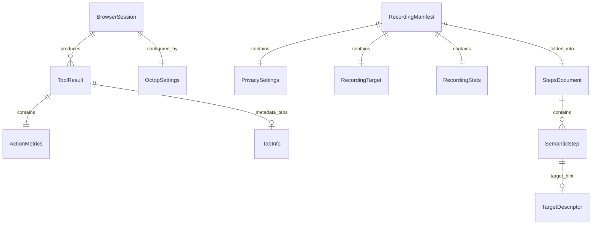

# 领域模型总览与持久化归属

本仓没有数据库，所有"模型"都是 Pydantic 模型或 dataclass，它们的生命周期只有三种：调用栈内瞬时对象、进程内单例配置、本机 JSON/JSONL 文件。本页给出总表，字段字典分别见 [工具结果与配置](toolresult-and-settings.md) 和 [录制产物](recording-artifacts.md)。

## 1. 模型全表与归属

| 模型 / 类型 | 定义锚点 | 生命周期 | 持久化位置 | 主要 Reader / Writer |
|---|---|---|---|---|
| `ToolResult` | `src/octop_browser/models.py:20` | 每次动作瞬时 | 仅 `--json` 输出或 MCP 响应 | Writer：`session.py` 各动作、`src/octop_browser/tool_interface.py:46`；Reader：CLI/MCP/回放 |
| `ActionMetrics` | `src/octop_browser/models.py:10` | 随 `ToolResult` 瞬时 | 不落盘；`metrics_summary()` 进程内聚合 | Writer：`src/octop_browser/session.py:895-903`、各 action 的 `_metrics()` |
| `TabInfo` | `src/octop_browser/models.py:36` | `list_tabs` 时构造 | `metadata["tabs"]` 中返回 | Writer：`src/octop_browser/session.py:820-829` |
| `OctopSettings` | `src/octop_browser/settings.py:110` | 实例 / 模块级单例 | 环境变量 → 对象，不落盘 | Writer：`src/octop_browser/settings.py:185`；Reader：session/launcher/installer |
| `BrowserMode` | `src/octop_browser/mode.py:21` | 类型别名 | 无 | `normalize_mode()` / `resolve_headless()` |
| `PrivacySettings` | `src/octop_browser/record/models.py:14` | 随录制清单 | `manifest.json` 的 `privacy` 段 | Writer：`src/octop_browser/record/recorder.py:376`；Reader：`privacy.py` |
| `RecordingTarget` | `src/octop_browser/record/models.py:20` | 随录制清单 | `manifest.json` 的 `target` 段 | Writer：`src/octop_browser/record/recorder.py:372-375`、`:252-253` |
| `RecordingStats` | `src/octop_browser/record/models.py:27` | 随录制清单 | `manifest.json` 的 `stats` 段 | Writer：`src/octop_browser/record/recorder.py:250`、`:402` |
| `RecordingManifest` | `src/octop_browser/record/models.py:32` | 录制周期 | `manifest.json` 原子替换写 | `src/octop_browser/record/store.py:64-80` |
| `TargetDescriptor` | `src/octop_browser/record/models.py:46` | 原始事件内 | `events.jsonl` 的 `target` 段 | JS `describeElement()` → `src/octop_browser/record/injected/recorder.js:201` |
| `SemanticStep` | `src/octop_browser/record/models.py:69` | 折叠后 | `steps.json` 的 `steps[]` | Writer：`semantic.py`；Reader：`matcher.py`/`replay.py` |
| `StepsDocument` | `src/octop_browser/record/models.py:80` | 折叠后 | `steps.json` 顶层 | Writer：`src/octop_browser/record/semantic.py:345-351`；Reader：`src/octop_browser/record/replay.py:31` |
| `RecordReplaySettings` | `src/octop_browser/record/settings.py:22` | 模块级单例 | 环境变量 → 对象 | `store.py`/`recorder.py`/`daemon.py` |
| `DownloadCandidate` | `src/octop_browser/playwright_download.py:30` | 安装期瞬时 | 无 | `race_download_sources()` |
| `InstallEvent` | `src/octop_browser/install.py:81` | 流式事件 | 无 | `install_chromium_stream()` → MCP |
| `InstallStep` | `src/octop_browser/linux_deps.py:172` | 安装期瞬时 | 无 | `build_install_steps()` |

## 2. 关系图

## 3. 字段命名与别名铁律

- Pydantic 模型使用 `Field(alias=...)` 把 Python snake_case 映射为文件里的驼峰键：`recordingId`/`schemaVersion`/`createdAt`/`endedAt`/`startUrl`/`accessibleName`/`nameAttr`/`testId`/`selectorCandidates` (`src/octop_browser/record/models.py:33-59`、`:81-83`)。
- `model_config = {"populate_by_name": True}` 允许两种命名互相填充；`TargetDescriptor` 额外开 `extra="allow"`，因为 JS 注入器会写入未建模字段 (`src/octop_browser/record/models.py:66`)。
- 序列化统一用 `model_dump(mode="json", by_alias=True)`，避免把 Python 字段名写进磁盘 (`src/octop_browser/record/store.py:68-75`、`src/octop_browser/cli.py:589`)。
- `ToolResult.content` 是 `str | dict[str, object]`，下游必须判类型后再消费；MCP 侧统一 `str(...)` 转文本 (`src/octop_browser/mcp_server.py:476`)。

## 4. 共变耦合与修改清单

1. 给任一持久化模型加字段：改模型 → 更新 `Field(alias=...)` → 更新 Writer 构造点 → 更新 Reader 默认值兜底 → 补 `tests/unit/test_models.py` 或 `tests/unit/test_record_replay_store_skill.py`。
2. 改别名会破坏已有录制文件的读取兼容性；必须保留旧别名回退路径或显式声明不兼容。
3. 改 `OctopSettings` 字段须同步 [配置字典](../../contracts/configuration.md) 与 `tests/unit/test_settings.py`。
4. 必跑：`uv run pytest tests/unit/test_models.py tests/unit/test_settings.py tests/unit/test_record_replay_store_skill.py -q`。
