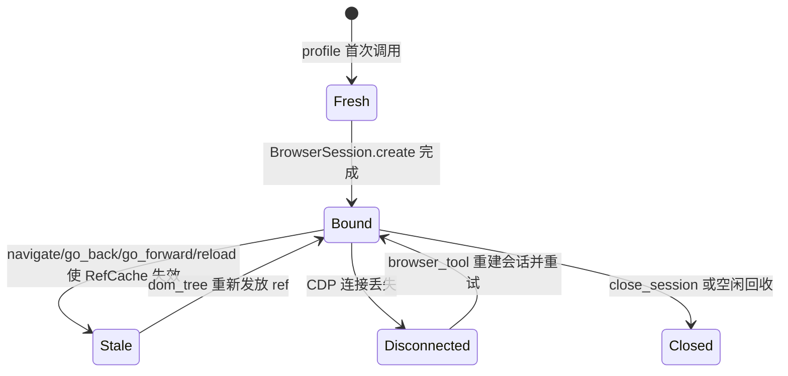

# `WF-01` · 单次浏览器动作执行

触发源为 CLI 子命令、MCP Tool 或 Python SDK 调用；目标是按 profile 定位或创建会话，执行一个动作并返回可观测的 `ToolResult`。全过程同步完成，不落业务数据库，唯一副作用是截图文件与 Chrome 页面状态。

## 1. 端到端符号调用树

```text
Trigger: browser_tool(action, profile, mode, urls, **kwargs) src/octop_browser/tool_interface.py:91
  ├─ [准入] :120 action in _KNOWN_ACTIONS（20 项）否则 _error_result()
  ├─ [特例] :125 close_session -> registry.pop + sess.close(kill=) + 可选 terminate_browser()
  ├─ [会话] :57 profile 命中 _registry 则复用，否则 BrowserSession.create() src/octop_browser/session.py:199
  │    └─ 导航模式仲裁 :231-235（headless 显式 > mode 显式 > cfg.browser_mode）
  ├─ [多标签补偿] :172 urls 非空且会话已存在 -> navigate(首个) / new_tab(force_new=True)
  ├─ [钩子] src/octop_browser/session.py:263 _fire("before_action", {"action", "params"})
  ├─ [动作分发] src/octop_browser/tool_interface.py:180 getattr(sess, action)(**kwargs)
  │    ├─ navigate :262 -> src/octop_browser/actions/navigate.py:25 invalidate -> Page.navigate -> 最多等 5s load
  │    ├─ dom_tree :300 -> DOM.getDocument(depth=-1) -> DOMBuilder.build(level) -> tokens=len//4
  │    ├─ click :377 -> src/octop_browser/actions/interact.py:63 _resolve_coords -> DOM.getBoxModel -> 两次鼠标事件
  │    ├─ type/fill :396/:416 -> 先 click -> 逐字符 Input.dispatchKeyEvent
  │    ├─ wait :491 -> 轮询 Runtime.evaluate，0.25s 间隔，默认 10s 截止
  │    └─ screenshot :348 -> src/octop_browser/actions/capture.py:87 -> Page.captureScreenshot -> 写 PNG -> metadata
  ├─ [记账] src/octop_browser/session.py:895 _record(result) -> 计数/耗时/token -> _fire(after_action|action_error)
  └─ [异常] src/octop_browser/tool_interface.py:183 TypeError -> 参数错误；:186 断线错误 -> 重建会话重试一次
```

## 2. 精确规则与阈值表

| 阶段 | 负责函数（`路径:行号`） | 精确条件 / 阈值 | 命中分支行为 |
|---|---|---|---|
| 动作准入 | `browser_tool` (`src/octop_browser/tool_interface.py:120`) | `action not in _KNOWN_ACTIONS` | 返回错误串含 20 个合法动作排序列表 |
| 模式仲裁 | `BrowserSession.create` (`src/octop_browser/session.py:231-235`) | `headless is not None` → 直接采用；否则 `normalize_mode(mode)` 或 `cfg.browser_mode` 交给 `resolve_headless()` | `auto` 在有桌面环境时 headed，否则 headless |
| ref 生命周期 | `navigate` (`src/octop_browser/actions/navigate.py:28`) | 无条件 `ref_cache.invalidate()` | 旧 ref 立即失效；调用方须重取 DOM |
| 页面加载等待 | `navigate` (`src/octop_browser/actions/navigate.py:13`、`:47`) | `asyncio.wait_for(load_event, timeout=5.0)`，超时仅 `pass` | 超时不判失败，返回 `Navigated to {url}` |
| 点击定位 | `_resolve_coords` (`src/octop_browser/actions/interact.py:41-60`) | 优先级 `ref > selector > (x,y)`；全无则 `ValueError` | ref 未命中抛 `CDPSessionError` 并提示先调 `dom_tree()` |
| 滚动方向 | `scroll` (`src/octop_browser/actions/interact.py:120-132`) | `direction=="down"` → `deltaY=+amount`；`up` → 负；`left/right` → `deltaX` | 固定鼠标位置 (400,300) |
| 等待条件 | `wait` (`src/octop_browser/session.py:521-526`) | `url_contains` 子串、`text` 子串、`selector` 存在性三者同时成立 | 10s 内满足即成功，否则返回 `Timeout waiting for condition` |
| 截图裁剪优先级 | `screenshot` (`src/octop_browser/actions/capture.py:130-168`) | `element_ref` 存在时忽略 `full_page` | 元素盒模型 content 8 点取 min/max 得到 clip |
| token 估算 | `dom_tree` (`src/octop_browser/session.py:327`)、`eval_js` (`src/octop_browser/actions/js_eval.py:49`) | `len(content) // 4` | 所有文本类动作沿用同一口径 |
| 断线重试 | `_is_disconnected_error` (`src/octop_browser/tool_interface.py:83-88`) | `CDPSessionError` 文本含 `not connected`/`connection lost` | 仅重试一次，参数原样复用 |

## 3. 状态机：会话与 ref 的有效性



不变量：任何跨文档跳转都必须先清 `RefCache`；`switch_to_target()` 重建 `CDPClient` 后也清空 (`src/octop_browser/session.py:141`)。`page_navigated` 事件虽被 `on()` 接受，但当前没有任何代码路径发射 (`src/octop_browser/hooks.py:33-34`)，不可依赖它做导航感知。

## 4. 异常、降级与副作用表

| 场景 | 检测条件 | 保护动作 | 锚点 |
|---|---|---|---|
| 导航返回错误 | `Page.navigate` 的 `result["errorText"]` 非空 | 短路为 `success=False`，不等待 load 事件 | `src/octop_browser/actions/navigate.py:38-45` |
| 导航事件超时 | 5s 内无 `Page.loadEventFired` | 忽略超时、仍判成功 | `src/octop_browser/actions/navigate.py:46-49` |
| JS 执行异常 | `Runtime.evaluate` 返回 `result.subtype == "error"` | 用 `description` 作为 `ToolResult.error` | `src/octop_browser/actions/js_eval.py:28-40` |
| 截图无数据 | `captureScreenshot` 返回空 `data` | `success=False`，错误 `Page.captureScreenshot returned empty data` | `src/octop_browser/actions/capture.py:171-183` |
| 钩子回调抛异常 | `_fire()` 内任意异常 | `logger.exception` 后继续动作，不影响结果 | `src/octop_browser/hooks.py:48-53` |
| 新标签导航失败 | `new_tab` 的 `navigation_result.success=False` | 关闭刚建的目标并切回前一个 target | `src/octop_browser/session.py:614-630`、`:658-673` |
| 动作抛未知异常 | `browser_tool` 外层 except | 统一转 `ToolResult.success=False` | `src/octop_browser/tool_interface.py:211-212` |

## 5. 共变耦合与修改清单

1. 新增动作：`session.py` 加方法 → `src/octop_browser/tool_interface.py:20` 白名单 → [MCP Schema](../contracts/api/mcp-tools.md) → [CLI 命令](../contracts/api/cli-commands.md) → 本页调用树与规则表。
2. 修改 token 口径：同时改 `dom_tree`、`eval_js`、`list_tabs` 三处 `//4`，并回归 `tests/unit/test_dom_builder.py`。
3. 修改等待/阈值：同步 [回放验证](../business/wf-record-replay.md) 的 `timeout_ms=10000` 与 `tests/unit/test_navigate_actions.py`。
4. 必跑：`uv run pytest tests/unit/test_navigate_actions.py tests/unit/test_dom_builder.py tests/unit/test_tool_interface.py tests/unit/test_hooks.py -q`。
