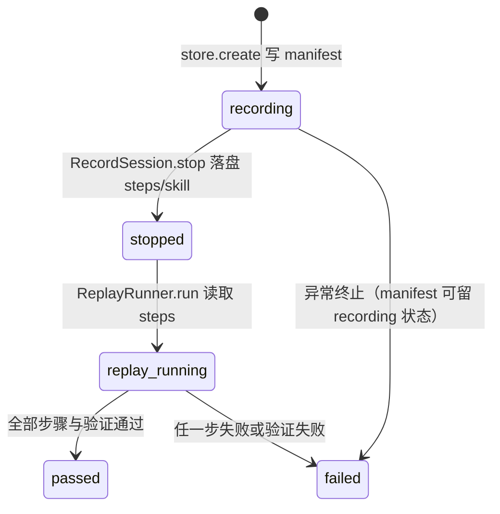

# `WF-03` · 录制 → 语义折叠 → 技能引导回放

触发源是 `octop-browser record ...` / `replay run <id>` 或对应 MCP Tool。录制产出落在本机 `record-replay/recordings/<id>/`，回放不依赖原始坐标或 ref，而是重新解释语义步骤并在当前 DOM 上重新匹配目标。

## 1. 端到端符号调用树

```text
[启动] src/octop_browser/cli.py:557 record start（无 --duration）
  ├─ ensure_daemon() src/octop_browser/record/daemon.py:190 -> start_daemon_process() :176
  └─ send_request({"command":"start",...}) src/octop_browser/record/daemon.py:140
       └─ RecordDaemon.dispatch() :39 -> RecordController.start_in_process() src/octop_browser/record/recorder.py:350

[录制] RecordController.start_in_process() src/octop_browser/record/recorder.py:350
  ├─ _attach(profile) :331 -> launch_or_attach + get_page_ws_url
  ├─ CDPClient.connect(ws) :357 -> Runtime.evaluate 取 start_url/title :359-366
  ├─ _recording_id() :43 -> rec_<YYYYmmdd_HHMMSS>_<hex6>
  ├─ store.create(manifest) :378 -> 目录与 manifest/events 落盘
  └─ RecordSession.start() :83
       ├─ _install_on_client() :165 -> addBinding + addScriptToEvaluateOnNewDocument
       ├─ _attach_known_targets() :193 -> 多标签都注入
       └─ _poll_targets() :220 -> 0.5s 轮询新/消失的 page target

[JS 采集] src/octop_browser/record/injected/recorder.js:333 事件监听 -> emit() :55
  ├─ click/dblclick :251-259；input(300ms 防抖)/change :264-272
  ├─ keydown 仅 Enter/Tab/Escape/方向键 :281-288
  ├─ scroll 500ms 节流 :289-297；submit 后 0ms/50ms 检查 URL :273-280
  └─ history.pushState/replaceState 猴补丁 + popstate/hashchange :304-341

[停止] daemon stop -> RecordSession.stop() src/octop_browser/record/recorder.py:101
  ├─ 取消 poll、status="stopped"、ended_at=_now() :104-112
  ├─ SemanticProcessor.process() src/octop_browser/record/semantic.py:338 -> steps.json
  └─ SkillGenerator.generate() src/octop_browser/record/skill_generator.py:32 -> draft.skill.md

[回放] ReplayRunner.run() src/octop_browser/record/replay.py:25
  ├─ read_steps() :31 -> 无步骤则 RuntimeError
  ├─ 每步：open/navigate -> browser_tool("navigate"|"new_tab")
  ├─ click/fill/select/set_checked -> dom_tree(structured) :112 -> match_target() :117
  │    └─ 命中 ref 则发对应动作；未命中走 selector/xpath JS -> bbox 兜底 :469-497
  ├─ 多标签：target_map 记录 录制id→运行时id，每步前 switch_tab :307-327
  ├─ 验证：url_contains/text_contains/selector_exists/title_contains/... :329-423
  └─ _write_report() :647 -> replay-reports/replay_<ts>.json；失败额外写 failure_* 目录
```

## 2. 精确规则与阈值表

| 阶段 | 负责函数（`路径:行号`） | 精确条件 / 阈值 | 命中行为 |
|---|---|---|---|
| 事件大小门禁 | `_on_binding_called` (`src/octop_browser/record/recorder.py:265`) | UTF-8 字节数 `> max_event_bytes`（默认 65536） | 静默丢弃 |
| 事件频率门禁 | `_rate_limit_ok` (`src/octop_browser/record/recorder.py:232-238`) | 每秒 `> max_events_per_second`（默认 100） | 静默丢弃 |
| 防伪造 | `src/octop_browser/record/recorder.py:273` | `payload["nonce"] != self.nonce` | 静默丢弃 |
| 输入防抖 | `onInput` (`src/octop_browser/record/injected/recorder.js:268`) | 300ms 后 `flushInput` | 连续输入只落 final 值 |
| 滚动节流 | `onScroll` (`src/octop_browser/record/injected/recorder.js:291`) | 两次间隔 `< 500ms` 直接返回 | 降低噪声 |
| 事件白名单 | `_filter_events` (`src/octop_browser/record/semantic.py:353-370`) | 16 种 `kind` 之外全部丢弃 | 不含 `recorder_installed` 之后的重复安装事件 |
| 低信号点击 | `_is_low_signal_result_click` (`src/octop_browser/record/semantic.py:277-316`) | 非交互 role/tag 且文本 ≥160 字符 | 该点击不生成步骤 |
| 变量推断 | `_var_for` (`src/octop_browser/record/semantic.py:122-170`) | `{{...}}`/邮箱/搜索词/日期/默认 slug 五分支 | 生成 `inputs[]` 并把步骤值替换为 `{{name}}` |
| 目标匹配 | `match_target` (`src/octop_browser/record/matcher.py:33-62`) | selector 80 + id 70 + nameAttr 60 + name 50 + role 25 + partial 20；阈值 45 | 低于阈值返回 `not-found` |
| 回放验证 | `ReplayRunner._run_verification` (`src/octop_browser/record/replay.py:341-415`) | 6 种验证类型，`wait` 超时统一 10000ms | 任一失败即整体 failed 并终止 |
| URL 变量替换 | `_resolve_url` (`src/octop_browser/record/replay.py:606-645`) | `{{key}}` 直接替换；`query` 存在时把百度 `wd=` / Google、Bing `q=` 换成新值 | 让搜索类录制回放为新查询 |
| 即时录制模式 | `src/octop_browser/cli.py:558-571` | `--duration > 0` | 进程内 `start_in_process` + sleep + stop + close，不经 daemon |

## 3. 产物状态机



不变量：`events.jsonl` 是追加写且每行 flush；`manifest.json` 用临时文件 `manifest.json.tmp` 原子替换写 (`src/octop_browser/record/store.py:64-76`)；`steps.json` 必须先于 `draft.skill.md` 生成，因为 `generate_skill()` 直接 `read_steps()` (`src/octop_browser/record/recorder.py:411-417`)。

## 4. 隐私、失败产物与补偿

| 场景 | 保护动作 | 锚点 |
|---|---|---|
| 敏感输入 | JS 端 `readValue()` 与 Python `redact_event()` 双层脱敏为 `{{sensitive_value}}` | `src/octop_browser/record/injected/recorder.js:243-249`、`src/octop_browser/record/privacy.py:74-81` |
| URL 敏感查询串 | `redact_url()` 把 `token/access_token/code/state/session/key/secret/password/auth/jwt` 等 11 个键替换为 `***` | `src/octop_browser/record/privacy.py:12-40` |
| 瞬时风控/登录跳转 | `is_transient_auth_or_risk_url()` 识别微博 visitor/newlogin、百度 captcha、小红书 login/error；回放时标 `skipped` | `src/octop_browser/record/url_filter.py:11-41`、`src/octop_browser/record/replay.py:210-219` |
| 浏览器脚手架 URL | `about:blank`/`chrome://newtab*` 与 `chrome://`/`devtools://` 不保留为回放意图 | `src/octop_browser/record/url_filter.py:7-8`、`:44-53` |
| 目标匹配失败 | 写 `failure_<ts>_<step>/reason.txt`、`dom_snapshot.json`、`screenshot.png` 后终止 | `src/octop_browser/record/replay.py:425-467` |
| 切换标签失败 | 立即记 `failureArtifacts` 并终止，避免后续动作打在错误页面 | `src/octop_browser/record/replay.py:94-108` |
| 守护进程未启动 | `send_request()` 返回固定错误包络，CLI 退出码 1 | `src/octop_browser/record/daemon.py:152-159` |

## 5. 目录产物与共变清单

录制根目录由 `BROWSER_RECORD_REPLAY_DIR` 决定，默认 `<state_dir>/record-replay` (`src/octop_browser/record/settings.py:24-29`)。每个录制目录包含 `manifest.json`、`events.jsonl`、`steps.json`、`draft.skill.md` 与 `screenshots/`、`snapshots/`、`replay-reports/` 子目录 (`src/octop_browser/record/store.py:45-62`)。端到端本地验证脚本为 `scripts/record_replay_smoke.py:57`：录制 fill/select/click/submit，再用不同 `query` 回放并断言 URL。

- **共变**：改事件 `kind` 名称 → 同步 JS `emit()`、Python `_filter_events()`、`_build_steps()` 分支与 [录制引擎](../architecture/record-engine.md)。
- **共变**：改脱敏正则 → 同步 JS `SENSITIVE_RE`、Python `SENSITIVE_RE`/`URL_KEYS` 与 `tests/unit/test_record_replay_semantic.py`。
- **共变**：改验证类型 → 同步 `SkillGenerator._verification_md()` 文案与 `tests/unit/test_record_replay_replay_runner.py`。
- 必跑：`uv run pytest tests/unit/test_record_replay_semantic.py tests/unit/test_record_replay_replay_runner.py tests/unit/test_record_replay_store_skill.py tests/unit/test_record_daemon_client.py -q`；有 Chrome 时另跑 `python scripts/record_replay_smoke.py`。

- 关联阅读：[领域术语与符号映射](../overview/glossary.md)、[构建与单测映射](../operations/dev-and-test.md)。
