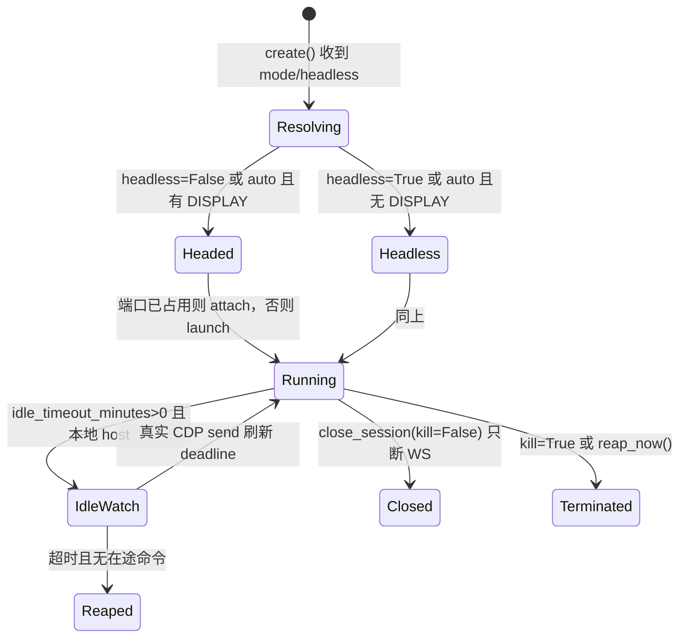

# `WF-02` · 会话生命周期与登录态持久化

触发源是首次动作调用或显式 `BrowserSession.create()`；目标是把 profile 名映射为固定端口与 user-data-dir，启动或重连 Chrome，并在空闲或显式关闭时精确回收本地进程。登录态完全依赖 Chrome 自己的用户目录，不另存 Cookie。

## 1. 端到端符号调用树

```text
BrowserSession.create(profile, headless, mode, urls, profile_manager, settings) src/octop_browser/session.py:199
  ├─ [配置] cfg = settings or _default_settings :226
  ├─ [目录] pm.get_or_create(profile) :228 -> src/octop_browser/profile.py:165
  │    ├─ data_dir = base_dir/profile，mkdir(parents=True) :169-170
  │    └─ _assign_port() :151 -> 读 .octop-browser-profiles.json，避开已用端口，回写
  ├─ [模式] headless 显式 > mode 显式 > cfg.browser_mode :231-235
  ├─ [内部会话] _InternalCDPSession(p, cfg) src/octop_browser/session.py:36
  │    ├─ idle_controller_for() src/octop_browser/idle.py:132 -> 仅本地且超时>0 时创建
  │    ├─ CDPClient(timeout=cfg.cdp_timeout, activity_tracker=controller) :42
  │    └─ RefCache() :46
  ├─ connect(headless) src/octop_browser/session.py:49
  │    ├─ [直连] cfg.cdp_ws_url 存在 -> 跳过 launcher :55-57
  │    └─ [本地] launch_or_attach() src/octop_browser/cdp/launcher.py:497 -> get_page_ws_url() :618
  │         -> CDPClient.connect(ws) :63 -> enable Page/DOM/Runtime :64-66
  │         -> Emulation.setDeviceMetricsOverride :86 -> idle.start() :72
  └─ [多标签] urls 首个 navigate，其余 new_tab(force_new=True) :241-248

关闭/回收：
  close_session -> src/octop_browser/tool_interface.py:125 -> registry.pop -> sess.close(kill=)
  空闲 60s 轮询 -> src/octop_browser/idle.py:111 _run() -> _check_once() :98 -> reap_now() :70
  kill=True 或 reap_now -> terminate_browser() src/octop_browser/cdp/launcher.py:440
       -> Browser.close :471 -> 3s 轮询端口 :479-483 -> pkill + clear locks :485-494
```

## 2. 端口、目录与粘滞目标规则表

| 规则 | 精确实现 | 锚点 |
|---|---|---|
| 端口分配 | `cdp_port_start` 起，跳过 `used_ports`，结果写 `profiles_dir/.octop-browser-profiles.json` | `src/octop_browser/profile.py:151-163` |
| 旧名兼容 | `.harness-browser-profiles.json` / `.harness-browser-target.json` 作为回退读取 | `src/octop_browser/profile.py:29-30`、`:126-129`、`:57-60` |
| 跨进程目标粘滞 | 页面 target id 写 `<profile>/.octop-browser-target.json`，下次 attach 优先复用 | `src/octop_browser/profile.py:69-84`、`src/octop_browser/cdp/launcher.py:653-660` |
| 目标失效处理 | 粘滞 id 不存在则 `clear_target()`，退到首个非 `about:blank` 页面 | `src/octop_browser/cdp/launcher.py:656-664` |
| 状态目录 | `~/.octop-browser`；若不存在而 `~/.harness-browser` 存在则沿用旧目录 | `src/octop_browser/settings.py:74-92` |
| 不可写迁移 | Linux `/root/...` 或写探针失败时迁移到 `/tmp/octop-browser-profiles-<uid>` | `src/octop_browser/cdp/launch_prep.py:144-186` |
| 启动自愈 | `XDG_RUNTIME_DIR` 强制写 `/tmp/runtime-octop-browser-<uid>`，清 Singleton 锁，必要时 `pkill` | `src/octop_browser/cdp/launch_prep.py:63-79`、`:82-98`、`:189-204` |
| 远程 host | 非 loopback 时禁止启动；已有端口仍可 attach | `src/octop_browser/cdp/launcher.py:516-523`、`:508-514` |

## 3. 模式解析与空闲回收状态机



`resolve_headless()` 的三态判定：`headless→True`、`headed→False`、`auto→not has_desktop_environment()` (`src/octop_browser/mode.py:55-75`)。macOS/Windows 恒有桌面；Linux 需 `DISPLAY` 或 `WAYLAND_DISPLAY` (`src/octop_browser/mode.py:43-52`)。空闲控制器的本地 host 白名单为 `{"localhost","127.0.0.1","::1"}`，远程直连模式永不回收 (`src/octop_browser/idle.py:18`、`:138`)。`send_passive()` 不刷新截止时间，避免健康探测掩盖真实空闲 (`src/octop_browser/cdp/client.py:118-122`)。

## 4. 失败补偿与并发约束

| 边界场景 | 检测条件 | 保护/回滚动作 | 锚点 |
|---|---|---|---|
| Chrome 启动即崩 | `process.poll() is not None` | 立即抛错并附 stderr tail，不等满重试预算 | `src/octop_browser/cdp/launcher.py:374-380` |
| Singleton 冲突（退出码 21） | stderr 含 `returncode=21`/`ProcessSingleton`/`SingletonLock` | `recover_profile()` 改名旧目录后重建，重试一次 | `src/octop_browser/cdp/launcher.py:585-613`、`src/octop_browser/cdp/launch_prep.py:231-251` |
| 无页面 target | `_list_page_targets()` 返回空 | `PUT /json/new?about:blank` 失败再 `GET` | `src/octop_browser/cdp/launcher.py:639-646`、`:685-712` |
| 优雅关闭不生效 | 3s 后端口仍占用 | `pkill -9 -f user-data-dir=...` 并清锁 | `src/octop_browser/cdp/launcher.py:479-494` |
| 回收失败重试 | `terminate_browser()` 返回 `False` | 把 `_last_activity` 回拨 `timeout - 60s`，下一轮再试 | `src/octop_browser/idle.py:86-89` |
| 会话重建竞态 | `browser_tool` 检测断线 | `_drop_session()` 先 pop 再 close，避免半初始化对象留在 registry | `src/octop_browser/tool_interface.py:71-80`、`:192-199` |

## 5. 共变清单与不变量

- **不变量**：同一 profile 名必须对应同一 `data_dir` 与同一 CDP 端口；禁止在业务代码里另建 Cookie 存储路径。
- **不变量**：任何 `cdp_host` 拼接都经 `OctopSettings`，远程 host 不发 `Browser.close`、不执行 `pkill`。
- **共变**：改端口文件/目标文件名 → 同步 `tests/unit/test_profile.py`、旧名兼容逻辑与 [配置字典](../contracts/configuration.md)。
- **共变**：改空闲判定 → 同步 `tests/unit/test_idle.py`、`tests/unit/test_launcher.py` 与 [排障 Runbook](../operations/runbook-and-observability.md)。
- 必跑：`uv run pytest tests/unit/test_profile.py tests/unit/test_idle.py tests/unit/test_launcher.py tests/unit/test_launch_prep.py tests/unit/test_session.py -q`（集成用例在无 Chrome 时整组跳过）。
