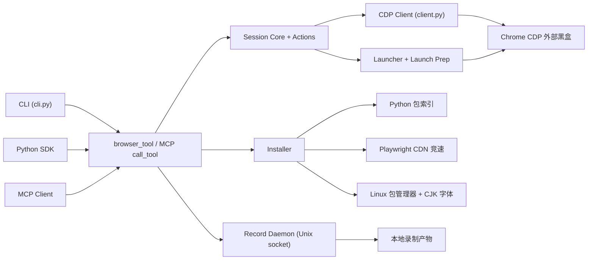

# 上下游集成与调用拓扑总览

本仓是浏览器自动化工具：上游是 CLI/MCP/Python 调用方，下游只有四类出向目标——Chrome CDP、Playwright CDN 与 pip、Linux 包管理器、本地录制守护进程。没有数据库、没有内部平台 RPC。

## 1. 双向拓扑图

## 2. 上游入向清单

| 上游方 | 入口符号 / 协议 | 到本仓的载荷 | 锚点 |
|---|---|---|---|
| CLI | `main()` / 33 子命令 | argparse Namespace → kwargs dict | `src/octop_browser/cli.py:426-499`、`:631` |
| MCP 客户端 | `list_tools`/`call_tool`（stdio 或 SSE） | `arguments: dict[str, Any]` | `src/octop_browser/mcp_server.py:367-479` |
| Python 调用方 | `browser_tool()` / `BrowserSession` 方法 | 关键字参数 | `src/octop_browser/tool_interface.py:91` |
| 录制回放内部 | `ReplayRunner.run()` 调 `browser_tool()` | `profile`/`ref`/`text`/`url` 等 | `src/octop_browser/record/replay.py:56`、`:120`、`:123` |

## 3. 下游系统总表

| 下游目标 | 通信方式 | 本仓封装文件 | 独立契约页 | 成功判定 |
|---|---|---|---|---|
| Chrome CDP | HTTP `/json*` + WebSocket 指令 | `cdp/client.py`、`cdp/launcher.py` | [chrome-cdp.md](downstream/chrome-cdp.md) | WebSocket 响应无 `error` 键 |
| Playwright CDN / pip | Range GET 探测 + `subprocess` 调用 CLI | `playwright_download.py`、`install.py` | [playwright-cdn.md](downstream/playwright-cdn.md) | 子进程 `returncode==0` 且二进制 `--version` 通过 |
| Linux 包管理器 / CJK 字体 | `subprocess` + `sudo -n` | `linux_deps.py`、`install.py` | [os-package-manager.md](downstream/os-package-manager.md) | 首个必需库步骤成功；字体失败不阻断 |
| 录制守护进程 | Unix socket 单行 JSON | `record/daemon.py` | [record-daemon.md](downstream/record-daemon.md) | 响应 `ok=true` 或 `status=passed` |

## 4. 参数转换层定位（防三明治夹心盲区）

本仓的「中间业务封装层」是 `tool_interface.py` + `session.py` + `actions/*`：上游 DTO（`argparse.Namespace` / MCP `arguments`）先转成 `kwargs`，再翻成 CDP 指令字典。两层字典的所有 Key 与来源见 [参数组装与字段映射](topology-and-mapping.md)。严禁只写 `CDPClient.send` 而漏掉业务封装层的字典拼装。

## 5. 共变清单

新增下游系统：建 `integrations/downstream/<target>.md` → 在本页第 3 节与根 INDEX 反查表登记 → 在映射页补字典表 → 更新 `fileToDocs`。必跑对应单测与 `make all`。
