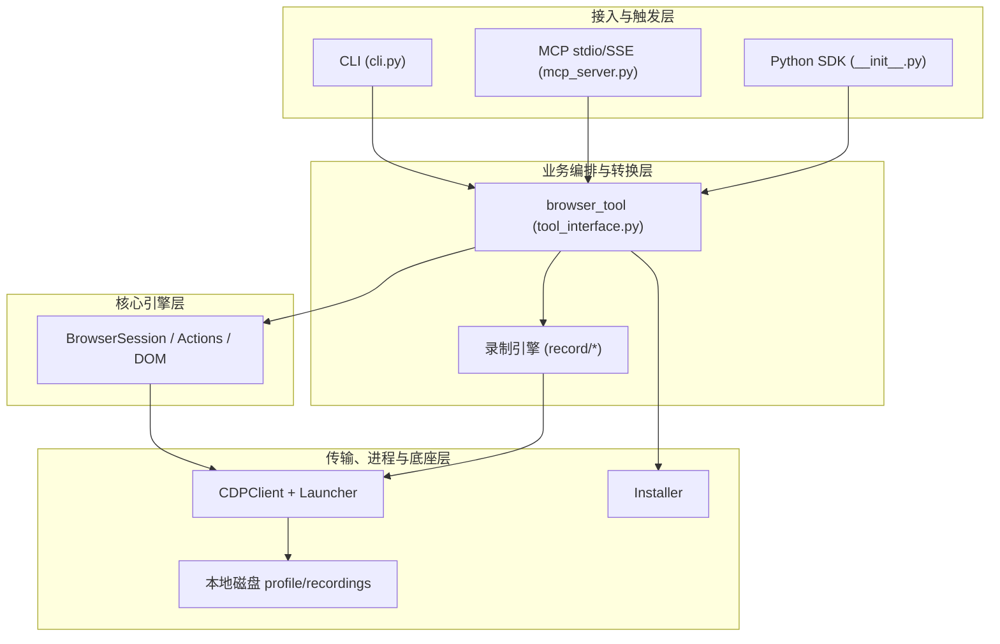

# 系统技术架构

`octop-browser` 是一个 Python 3.11+ 单进程库/CLI：它启动真实 Chromium，用手写 CDP over websockets 直接驱动，不经过 Playwright 运行时，并以 Python SDK、CLI、MCP 三种形态对外暴露同一套 20 个动作。核心隔离原则是「接入层只翻译参数、核心引擎只编排动作、传输底座独占进程与外部 I/O」。

## 1. 运行时分层与依赖拓扑



| 架构层 | 包含目录 / 文件 | 核心职责 | 越界禁令 |
|---|---|---|---|
| 接入与触发层 | `cli.py`、`mcp_server.py`、`__init__.py` | 协议解析、参数字典组装、输出格式化 | 禁止直接拼 CDP 指令字典 |
| 业务编排层 | `tool_interface.py`、`record/*` | profile 路由、动作白名单、录制折叠与回放 | 禁止自建 Cookie/Auth 存储 |
| 核心引擎层 | `session.py`、`actions/*`、`dom/*`、`hooks.py` | 动作编排、ref 生命周期、DOM 四级视图、指标钩子 | 禁止耦合 CLI/MCP 框架对象 |
| 传输与底座层 | `cdp/*`、`profile.py`、`idle.py`、`install.py`、`linux_deps.py` | CDP 帧、Chrome 进程、端口/目录、CDN 与系统库 | 外部域名与凭据一律走配置项；`localhost` 不硬编码 |

## 2. 进程启动装配与停机序列

```text
[CLI] src/octop_browser/cli.py:631 main() -> parse_args() -> _run_action() :514 -> browser_tool()
[MCP] src/octop_browser/mcp_server.py:527 stdio_server() / :491 SSE -> app.run() -> call_tool() :391
[SDK] 直接 await browser_tool(...) 或 BrowserSession.create()

装配链：
  src/octop_browser/tool_interface.py:57 _get_or_create_session(profile)
    -> src/octop_browser/session.py:199 BrowserSession.create()
       -> src/octop_browser/profile.py:165 get_or_create() -> 端口与 data_dir
       -> src/octop_browser/session.py:231-235 模式仲裁（headless > mode > cfg.browser_mode）
       -> src/octop_browser/session.py:49 _InternalCDPSession.connect()
          -> [直连] cfg.cdp_ws_url 直接连；[本地] src/octop_browser/cdp/launcher.py:497 launch_or_attach()
          -> src/octop_browser/cdp/client.py:56 connect(ws) + enable Page/DOM/Runtime
          -> src/octop_browser/session.py:74 _apply_viewport() + src/octop_browser/idle.py:43 start()

停机链：
  close_session(kill=False) -> client.close()（Chrome 保留）
  close_session(kill=True) / idle.reap_now() -> src/octop_browser/cdp/launcher.py:440 terminate_browser()
    -> Browser.close -> 3s 轮询 -> pkill + clear locks
```

## 3. 跨切面工程机制速查表

| 机制维度 | 核心符号与源码锚点 | 全局实现规则 |
|---|---|---|
| 配置单一源 | `OctopSettings` (`src/octop_browser/settings.py:110`)、`settings` 单例 (`:185`) | 每个字段 `default_factory` 重读环境；显式 settings 对象优先 |
| 认证与登录持久化 | `ProfileManager` (`src/octop_browser/profile.py:95`)、`Profile` (`:34`) | 同名 profile → 同一 user-data-dir → Cookie 复用；不另存 Cookie |
| 并发与卸载 | `asyncio.to_thread` (`src/octop_browser/install.py:514`、`src/octop_browser/cdp/launcher.py:490`)、函数内延迟 import | 阻塞子进程/探测卸载到线程池或保持异步 |
| 缓存与失效 | `RefCache.invalidate()` (`src/octop_browser/dom/refs.py:23`) | 导航/切目标必清；`build_download_candidates` 用 `seen` 去重 |
| 异常到结果映射 | `_error_result()` (`src/octop_browser/tool_interface.py:46`)、`CDPSessionError` (`src/octop_browser/cdp/client.py:19`) | 业务错误不抛到调用方，统一 `ToolResult.success=False` |
| 外部边界与降级 | `src/octop_browser/cdp/launcher.py:497`、`src/octop_browser/playwright_download.py:108`、`src/octop_browser/linux_deps.py:220` | 远程 host 只连不启；CDN 全失败回退目录顺序；字体失败不阻断 |
| 可观测性 | `logger.*`、`ToolResult.error`、`replay_*.json` | 无指标端口；日志不输出 nonce 与密钥 |

## 4. 技术栈事实表

| 维度 | 实现 | 锚点 |
|---|---|---|
| 传输 | `websockets>=12` 手写 CDP 帧，`aiohttp>=3.9` HTTP 探测 | `pyproject.toml:24-31`、`src/octop_browser/cdp/client.py:11-12` |
| 数据校验 | `pydantic>=2` 模型 | `pyproject.toml:26`、`src/octop_browser/models.py:7` |
| MCP | `mcp>=1.9,<3`（2.x 移除低层装饰器） | `pyproject.toml:28-30` |
| 构建 / 质量 | hatchling、ruff、mypy strict、pytest + coverage | `pyproject.toml:2-6`、`:55-83` |
| 入口 | `octop-browser = octop_browser.cli:main` | `pyproject.toml:49-50` |

组件注册表见 [架构索引](../architecture/index.md)，依赖边见 [模块依赖矩阵](../architecture/module-dep-matrix.md)，外部边界见 [认知边界](../operations/boundary.md)。
